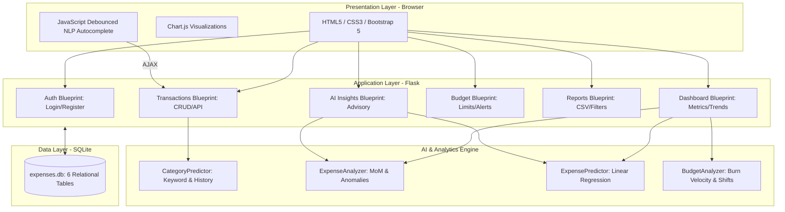
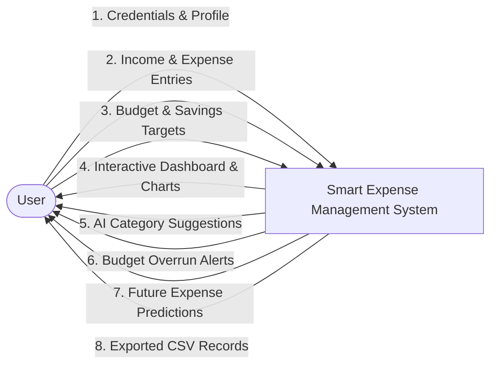
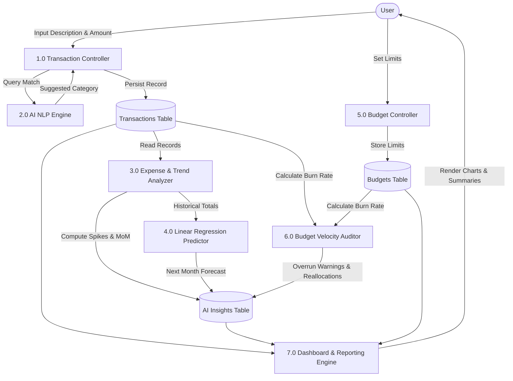

# Smart Expense Management System - Project Documentation

**Degree / Course:** Bachelor of Technology / Computer Science & Engineering / Information Technology  
**Project Category:** AI-Powered Full-Stack Web Application  
**Technologies:** Python Flask, SQLite, SQLAlchemy, Pandas, Scikit-Learn, HTML5, CSS3, JavaScript, Chart.js, Bootstrap 5  

---

## 1. Executive Summary & Problem Statement

Managing personal finances is critical for students and working professionals. Traditional spreadsheets or manual notebooks are cumbersome, prone to neglect, and fail to provide actionable intelligence.

The **Smart Expense Management System** solves this by providing:
1. **Effortless Recording:** One-stop transaction logging with instant AI categorization suggestions.
2. **Comprehensive Visibility:** Interactive dashboard with real-time balance, cash flow charts, and category breakdowns.
3. **Proactive Financial Guidance:** Intelligent budget limits, velocity tracking, and machine-learning predictions that alert users before they run out of money.

---

## 2. Software Requirements Specification (SRS)

### 2.1 Functional Requirements (FR)
- **FR 1.0 (Authentication):** Secure user registration, login with remember-me, session management, and profile password changes.
- **FR 2.0 (Transaction Management):** Full CRUD (Create, Read, Update, Delete) operations on income and expense transactions. Filter by date, category, type, and keyword search.
- **FR 3.0 (Category Management):** System default categories (Food, Shopping, Transport, Bills, etc.) and custom user-defined categories.
- **FR 4.0 (Budget Management):** Overall monthly budget and category-wise spending limits. Daily burn-rate calculations and threshold alerts ($80\%$ warning, $100\%$ over-budget).
- **FR 5.0 (Reports & Export):** Dynamic timeframe filtering (This Month, Last Month, 3 Months, Year, All-Time), interactive Chart.js graphs, and CSV data export.
- **FR 6.0 (AI-Powered Analytics):**
  - Real-time keyword & historical NLP category classification.
  - Anomaly detection for unusual purchases ($>1.5\sigma$).
  - Linear regression monthly expense forecasting.
  - Smart budget rebalance suggestions.
- **FR 7.0 (Savings Goals):** Target tracking, percentage completion indicators, and fund deposit logging.

### 2.2 Non-Functional Requirements (NFR)
- **Security:** Salted hashing (`pbkdf2:sha256`), CSRF protection on all mutating requests, SQL parameterization, user-level data isolation.
- **Usability:** Clean, responsive UI (Bootstrap 5) with dark/light visual contrast, mobile-friendly collapsible sidebar, and intuitive forms.
- **Performance:** Sub-100ms response times for SQLite queries and instantaneous client-side chart rendering.
- **Portability:** Self-contained SQLite database file; no expensive cloud database or paid API keys required.

---

## 3. System Architecture & Data Flow

### 3.1 High-Level Architecture

### 3.2 Data Flow Diagram (DFD Level 0 - Context Level)

### 3.3 Data Flow Diagram (DFD Level 1)

---

## 4. Database Schema Specifications

### Table 1: `users`
| Column | Type | Constraints | Description |
|---|---|---|---|
| `id` | Integer | Primary Key, Auto-increment | Unique user identifier |
| `name` | String(100) | Not Null | User's full name |
| `email` | String(120) | Unique, Not Null, Indexed | User login email |
| `password_hash`| String(255) | Not Null | PBKDF2:SHA256 salted password hash |
| `created_at` | DateTime | Default UTC | Registration timestamp |

### Table 2: `categories`
| Column | Type | Constraints | Description |
|---|---|---|---|
| `id` | Integer | Primary Key | Unique category ID |
| `user_id` | Integer | Foreign Key (`users.id`), Nullable | Null for default categories, user ID for custom |
| `name` | String(50) | Not Null | Category display name |
| `type` | String(20) | Not Null | `'income'` or `'expense'` |
| `icon` | String(50) | Default `'bi-tag'` | Bootstrap icon class |
| `color` | String(20) | Default `'#6366f1'` | Hex color code for charts |

### Table 3: `transactions`
| Column | Type | Constraints | Description |
|---|---|---|---|
| `id` | Integer | Primary Key | Transaction ID |
| `user_id` | Integer | Foreign Key (`users.id`), Not Null | Owner of transaction |
| `category_id` | Integer | Foreign Key (`categories.id`), Not Null | Category reference |
| `type` | String(20) | Not Null | `'income'` or `'expense'` |
| `amount` | Float | Not Null, $>0$ | Amount in INR |
| `description` | String(255) | Not Null | Transaction note / payee |
| `date` | Date | Not Null, Indexed | Date of transaction |
| `created_at` | DateTime | Default UTC | System log timestamp |

### Table 4: `budgets`
| Column | Type | Constraints | Description |
|---|---|---|---|
| `id` | Integer | Primary Key | Budget ID |
| `user_id` | Integer | Foreign Key (`users.id`), Not Null | User reference |
| `category_id` | Integer | Foreign Key (`categories.id`), Nullable | Null for overall monthly budget |
| `amount` | Float | Not Null, $>0$ | Budget spending limit |
| `month` | Integer | Not Null ($1-12$) | Target month |
| `year` | Integer | Not Null | Target year |

### Table 5: `savings_goals`
| Column | Type | Constraints | Description |
|---|---|---|---|
| `id` | Integer | Primary Key | Savings goal ID |
| `user_id` | Integer | Foreign Key (`users.id`), Not Null | Goal owner |
| `title` | String(100) | Not Null | Goal title (e.g. Emergency Fund) |
| `target_amount`| Float | Not Null, $>0$ | Target savings amount |
| `current_amount`| Float | Default $0.0$ | Accumulated savings |
| `deadline` | Date | Nullable | Target completion date |
| `created_at` | DateTime | Default UTC | Creation timestamp |

### Table 6: `ai_insights`
| Column | Type | Constraints | Description |
|---|---|---|---|
| `id` | Integer | Primary Key | Insight ID |
| `user_id` | Integer | Foreign Key (`users.id`), Not Null | Target user |
| `insight_type` | String(50) | Not Null | e.g. `'category_spike'`, `'prediction'`, `'budget_warning'` |
| `message` | Text | Not Null | Generated natural language guidance |
| `created_at` | DateTime | Default UTC | Generation timestamp |

---

## 5. Software Testing Report

The system was verified using automated pytest unit and integration tests.

| Test Case ID | Test Description | Input Data | Expected Output | Actual Result | Status |
|---|---|---|---|---|---|
| **TC-01** | User Registration | Valid email, matching passwords | Account created, redirected to dashboard | Redirected to dashboard, user persisted | **PASSED** |
| **TC-02** | Invalid Login Attempt | Existing user, wrong password | Error message: "Invalid email or password" | Flash error displayed, login denied | **PASSED** |
| **TC-03** | Record Expense | Type: Expense, ₹450, Swiggy | Expense saved, balance reduced | Transaction appears in list & totals | **PASSED** |
| **TC-04** | Edit Transaction | Change amount to ₹550 | Updated in database & UI | Amount updated correctly | **PASSED** |
| **TC-05** | Delete Transaction | Existing transaction ID | Transaction removed from database | Record deleted, balance updated | **PASSED** |
| **TC-06** | AI Categorization API | Description: "Swiggy food order" | Suggested category: "Food" | JSON response with "Food" ($>0.5$ conf) | **PASSED** |
| **TC-07** | Budget Limit & Overrun Alert | Budget: ₹5,000, Expense: ₹6,000 | Alert: "Overall Budget Exceeded" | Over budget alert displayed in UI | **PASSED** |
| **TC-08** | Savings Goal Progress | Target: ₹10,000, Deposit: ₹3,000 | Progress increases from $20\%$ to $50\%$ | Calculation verified at $50.0\%$ | **PASSED** |
| **TC-09** | Multi-User Data Isolation | User B accesses User A's transaction | HTTP 404 Access Denied | User B cannot view or edit User A records | **PASSED** |
| **TC-10** | Refresh AI Insights | Click "Refresh AI Analytics" | New insights generated & stored | Insights generated into DB Table 6 | **PASSED** |

---

## 6. Future Enhancements

1. **Receipt OCR (Optical Character Recognition):** Upload receipts via phone camera/photo using Tesseract or Google Cloud Vision to extract amount, store name, and date automatically.
2. **Bank Statement Import:** Parse CSV / OFX / PDF bank statements for bulk transaction reconciliation.
3. **Multi-Currency Support:** Auto-convert foreign currency transactions using real-time foreign exchange rates.
4. **LLM Conversational Advisor:** Plug in Gemini API to provide open-ended natural language financial chatting (e.g., *"How can I save ₹10,000 this month?"*).

