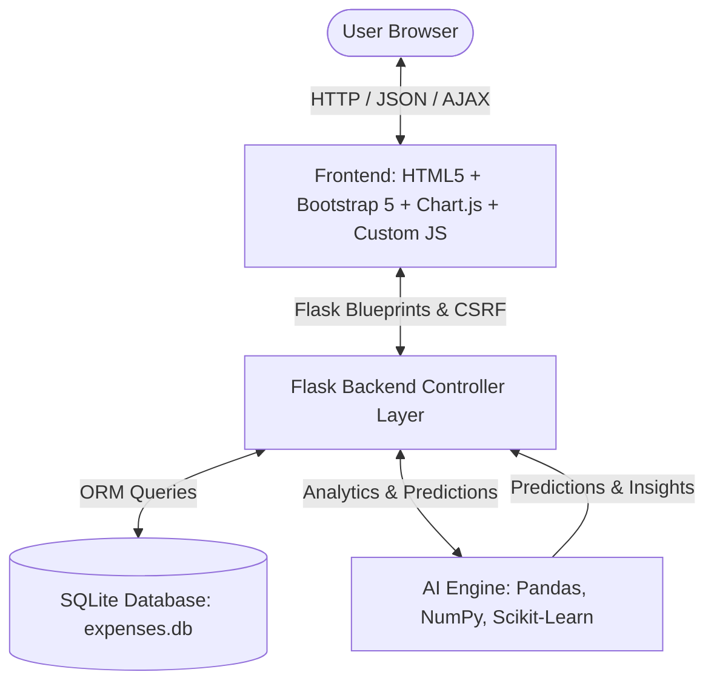
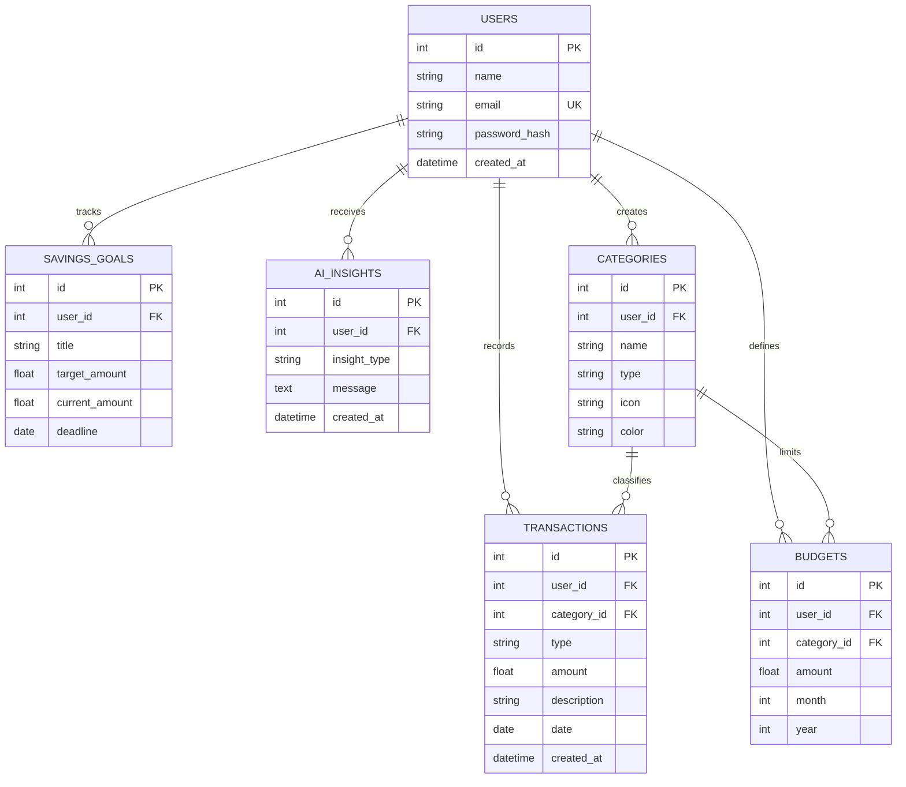

# Smart Expense Management System (AI-Powered)

An intelligent, full-stack personal finance web application built using **Python Flask**, **SQLite**, **SQLAlchemy**, **Pandas**, **Chart.js**, and **Bootstrap 5**. Designed as an end-to-end college capstone project demonstrating practical AI algorithms without relying on expensive or external paid APIs.

---

## 🌟 Key Highlights & AI Features

1. **AI Feature 1: Real-Time Automatic Categorization (NLP & History Matching)**
   - As you type a description (e.g., *"Swiggy food order"*, *"Uber ride to campus"*, *"Electricity bill"*), the AI scans lexical patterns and past transaction behaviors.
   - Live category recommendations appear in real time with an instant **"Apply"** button while preserving user override flexibility.

2. **AI Feature 2: Deep Spending Analysis & Anomaly Detection**
   - Automatically computes monthly category distributions and highlights top expenditure drains.
   - Detects unusual single-purchase spikes using statistical thresholds ($>1.5\sigma$ standard deviations from the user's monthly mean).
   - Generates Month-over-Month (MoM) variance analysis (e.g., *"Food spending increased by 22% compared with last month"*).

3. **AI Feature 3: Predictive Monthly Expense Forecasting (Machine Learning / Trend Regression)**
   - Utilizes historical expense sequences with **Linear Trend Regression** and **Weighted Moving Averages** to forecast next month's total spending and category allocations.

4. **AI Feature 4: Smart Budget Rebalance & Savings Velocity**
   - Tracks daily burn rate velocity ($\text{daily burn} \times \text{days in month}$) and warns users if projected spend will breach monthly budgets before month-end.
   - Recommends actionable budget reallocations (e.g., reallocating surplus funds from underutilized categories to exhausted ones).

---

## 🏗️ System Architecture



---

## 🗄️ Database Design (Entity-Relationship)



---

## 🚀 Quick Start Guide

### 1. Prerequisites
- Python 3.10+ (Python 3.11 recommended)
- Git (optional)

### 2. Start the Server Directly (Windows)
Double-click `start_app.bat` or run in PowerShell:
```powershell
.\start_app.ps1
```
Or run with Python directly:
```powershell
python run.py
```
Server starts on **`http://127.0.0.1:5000`**

### 3. Demo Credentials (Pre-Seeded with 4 Months of History)
For immediate evaluation with populated charts and AI analytics:
- **Email:** `demo@example.com`
- **Password:** `password123`
*(You can also click the "Auto-Fill" button on the Sign-In page)*

### 4. Re-seeding Data Anytime
To reset demo data back to clean state:
```powershell
python seed_data.py
```

---

## 🧪 Running Automated Tests

The project includes an automated test suite verifying User Authentication, CRUD transactions, Budget limits, Savings goals, AI prediction APIs, and Data Isolation between accounts:

```powershell
python -m pytest -v tests
```
**Results:** `8 passed, 0 failed`

---

## 📂 Project Structure

```
smart-expense-management/
├── app.py                     # Flask application factory, error handlers & context
├── config.py                  # Database & session configuration
├── run.py                     # Main execution entry point
├── forms.py                   # Flask-WTF CSRF forms & validation
├── seed_data.py               # Pre-populated realistic demonstration data
├── start_app.bat              # 1-click Windows launcher
├── start_app.ps1              # PowerShell launcher
├── requirements.txt           # Project dependencies
│
├── models/                    # SQLAlchemy database models
│   ├── __init__.py            # DB initialization & imports
│   ├── user.py                # Users & password hashing
│   ├── category.py            # Categories & system defaults
│   ├── transaction.py         # Incomes and expenses
│   ├── budget.py              # Overall & category monthly budgets
│   ├── savings.py             # Savings goals & fund progress
│   └── ai_insight.py          # AI insight records
│
├── routes/                    # Modular Flask Blueprints
│   ├── __init__.py
│   ├── auth.py                # Register, Login, Logout, Profile
│   ├── dashboard.py           # Dashboard stats & Chart.js payloads
│   ├── transactions.py        # Transaction CRUD & AJAX Categorization API
│   ├── budgets.py             # Budget settings & burn-rate calculations
│   ├── reports.py             # Period filters, Chart.js trends, CSV export
│   ├── insights.py            # AI Advisory Center & Health Index
│   ├── savings.py             # Savings goals & deposit tracking
│   └── categories.py          # Custom & default category manager
│
├── services/                  # AI & Statistical Processing Engines
│   ├── __init__.py
│   ├── category_predictor.py  # AI Feature 1: Keyword & pattern classifier
│   ├── expense_analyzer.py    # AI Feature 2: High drain & spike detector
│   ├── expense_predictor.py   # AI Feature 3: Linear trend regression & forecast
│   └── budget_analyzer.py     # AI Feature 4: Budget burn-rate & rebalance
│
├── static/
│   ├── css/style.css          # Modern SaaS UI styling & responsive layout
│   └── js/
│       ├── main.js            # Live AI autocomplete, alerts, dynamic dropdowns
│       └── dashboard.js       # Chart initialization helpers
│
├── templates/                 # Jinja2 HTML5 Templates
│   ├── base.html              # Responsive layout with sidebar & top nav
│   ├── login.html             # Sign in with 1-click demo credentials
│   ├── register.html          # New account registration
│   ├── dashboard.html         # Main dashboard with 4 KPI cards & 2 charts
│   ├── transactions.html      # Searchable, filterable transaction table
│   ├── add_transaction.html   # Add transaction with real-time AI categorization
│   ├── edit_transaction.html  # Edit existing transaction
│   ├── budgets.html           # Budget progress bars, velocity & alerts
│   ├── reports.html           # Financial report summaries & charts
│   ├── insights.html          # AI Financial Advisory Center
│   ├── savings.html           # Savings milestones & deposits
│   ├── categories.html        # Category manager
│   ├── profile.html           # User profile & password changer
│   ├── 404.html               # Not found error page
│   └── 500.html               # Internal server error page
│
└── tests/                     # Pytest Unit Test Suite
    ├── test_auth.py           # Authentication & security tests
    ├── test_transactions.py   # Transaction CRUD, AI API & User isolation
    └── test_budget.py         # Budget alerts, savings & AI refresh tests
```

---

## 🎓 College Viva & Presentation Q&A Guide

**Q1: How does the AI Categorization work without an internet connection?**
> **Answer:** It uses an internal rule-based Natural Language Processing (NLP) tokenizer that checks keyword stems and regular expressions against financial lexicons, combined with continuous Bayesian learning from the user's past recorded transactions.

**Q2: What algorithm is used for Next Month Expense Prediction?**
> **Answer:** It implements **Linear Trend Regression ($y = mx + c$)** using NumPy/Scikit-Learn over historical monthly spend sequences when 3+ months exist, with a fallback to **Weighted Rolling Moving Averages** ($60\%$ latest month, $40\%$ prior month) for smaller datasets.

**Q3: How is user privacy and data security ensured?**
> **Answer:**
> - Passwords use **Werkzeug salted PBKDF2:SHA256** hashing.
> - **Flask-WTF CSRF tokens** protect all form submissions from cross-site request forgery.
> - **Parameterized ORM queries (SQLAlchemy)** prevent SQL Injection.
> - All queries enforce strict user scoping (`user_id == current_user.id`), preventing unauthorized cross-user access (verified in automated tests).

